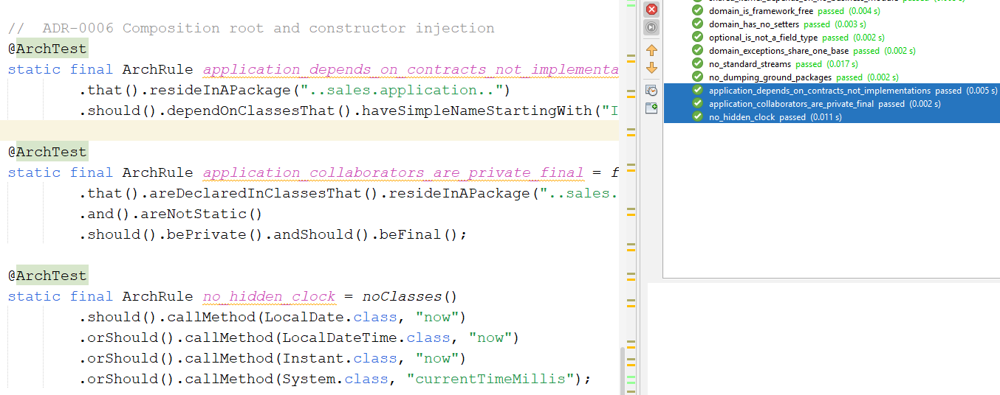
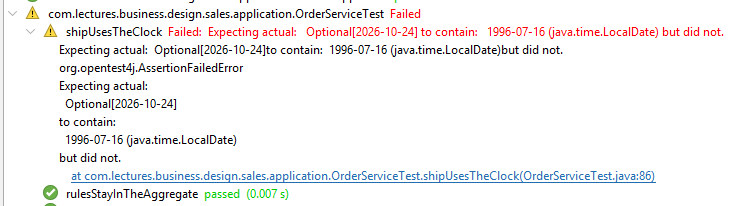
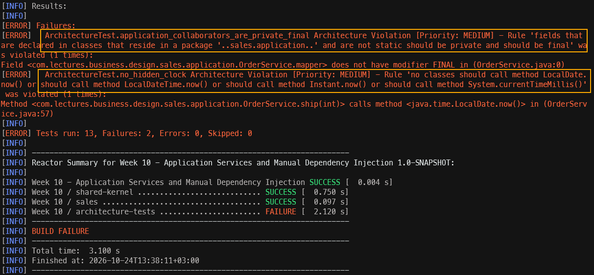
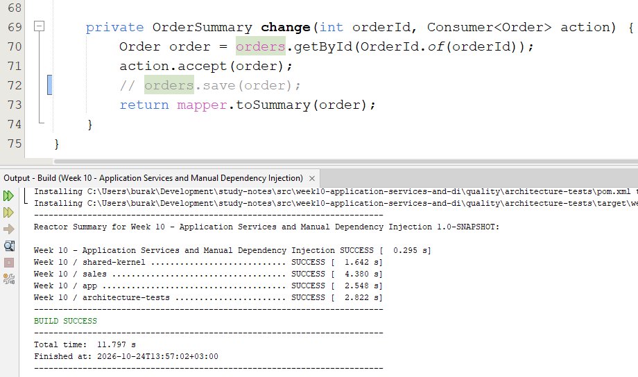

<a id="top"></a>

# Bölüm 10: Uygulama Servisleri ve Manuel Dependency Injection

<!-- nav:top:start -->
[← Bölüm 09](java-chapter-09.md#top) · [İçindekiler](README.md#top) · [Bölüm 11 →](java-chapter-11.md#top)
<!-- nav:top:end -->

Bir önceki bölümde kodumuzu Maven modüllerine ayırıp paketler arasındaki bağımlılık yönlerini ArchUnit testleriyle koruma altına aldık. Lakin sales modülünün dış dünyaya sunduğu yetenekler hala sınırlı. SalesReport aslında sadece okuma yapıyor. Sipariş oluşturmak, onaylamak veya kargoya vermek isteyen bir istemcinin Order nesnesini oluşturup ilgili metotları çağırması ve sonucu repository'ye kaydetmesi gerekiyor. BusinessDesign sınıfındaki main metodunda yaptığımız şey tam olarak buydu. Genellikle kurumsal çözümlerde bu süreçler bir HTTP isteği *(REST API çağrısı, WEB formu vb.)*, bir mesaj kuyruğu tüketicisi *(RabbitMQ Consumer)* veya zamanlanmış bir görev *(Task Scheduler)* tarafından tetiklenir. Bu tetikleyicilerin her biri domain nesnelerini doğrudan kullanmaya başlarsa bir önceki bölümde çizdiğimiz sınırların da bir anlamı kalmaz. Dolayısıyla bu bölümde aşağıdaki sorulara cevap aramaya çalışacağız.

- Bir kullanım senaryosu *(use case)* hangi sınıfta yaşamalıdır? *(Domain nesnesinde mi yoksa onun bir üst katmanında mı?)*
- Bir servis ihtiyaç duyduğu bileşenleri nereden almalıdır? *(new çağrısının yeri neresidir?)*
- Zaman olarak bugün bilgisi koda nasıl girmelidir? *(Bölüm 3'te ele aldığımız `ship(LocalDate date)` sorusunu hatırlayalım)*
- Bir Dependency Injection Container sistemi *(CDI, Spring)* tam olarak neyi otomatikleştirir?

## Use Case Nedir?

Bir use case'in SalesReport'tan farkı nedir sorusunuz düşünerek başlayabiliriz. Şu ana kadar application paketine eklediğimiz iki sınıf var. OrderMapper ve SalesReport. SalesReport okuma yönünde çalışan bir sınıf. Repository üzerinden siparişleri alır ve gruplayarak raporlar üretir. Sistemin durumunu değiştiren hiçbir işlem yapmaz. Yazma yönündeki işlemler içinse genellikle aşağıdaki gibi bir akış söz konusu olur.

```text
1. İşlem komutunu çevir      PlaceOrderCommand -> CustomerId, Money, ...
2. Aggregate'ı yükle         customers.getById(), orders.getById()
3. Kararı ona bırak          order.confirm(), order.ship(date),...
4. Kaydet                    orders.save(order)
5. Çıktıyı çevir             mapper.toSummary(order) -> OrderSummary
```

Bu akışa dikkat edersek 3ncü adım dışında hiçbirinin bir iş kuralı içermediğini görürüz. Siparişin hangi durumdan hangi duruma geçebileceği, kargo tarihinin sipariş tarihinden önce olamayacağı ya da adres bilgisi olmayan bir siparişin onaylanamayacağı gibi kurallar zaten **Order** sınıfının içinde yer almakta. Uygulama servisi *(application service)* bu kuralları bilmez *(ki bilmek zorunda da değildir)* sadece akışı koordine eder. Bu ayrım önemlidir çünkü iş kuralları *(business rules)* servis sınıfına sızmaya başladığında *(örneğin `if (order.status() == DRAFT && ...)` gibi kontroller eklendiğinde)* domain modelimiz yeniden anemik hale gelmeye başlar. Aslında kaçmaya çalıştığımız şey budur.

> Martin Fowler bu katmanı **Service Layer** olarak adlandırır ve *"uygulamanın sınırını tanımlar, mevcut işlemleri belirler ve her işlemin yanıtını koordine eder"* şeklinde tarifler. DDD *(Domain Driven Design)* literatüründe ise **Application Service** terimi kullanılır. Kural yine aynıdır; ince bir koordinasyon katmanı.

### Tek Sınıf mı, Senaryo Başına Bir Sınıf mı?

Kullanım senaryolarını *(Use Case)* organize etmenin iki yaygın yolu vardır.

| **Yaklaşım** | **Örnek** | **Pros** | **Cons** |
| --- | --- | --- | --- |
| **Aggregate başına bir servis** | `OrderService.placeOrder / confirm / ship / cancel` | Az sayıda sınıf yer alır. İlgili senaryolar bir arada durur. **Jakarta EE** ve **Spring** dünyasında en sık görülen yapılardandır. | Senaryo sayısı arttıkça sınıf büyür ve her metot tüm bağımlılıkları kullanmasa bile hepsini taşır. |
| **Senaryo başına bir sınıf** | PlaceOrderHandler, ShipOrderHandler gibi | Her sınıfın tek bir sorumluluğu ve kendi bağımlılık listesi olur *(SRP - Single Responsibility Principle)*. CQRS'e *(Command Query Responsibility Segregation)* geçiş kolaylaşır. | Sınıf sayısı hızla artar. Küçük projelerde abartılı bir seremoniyi *(ceremony)* hissettirir :D |

Şimdilik ilk senaryo ile devam edelim. Kalanını tartışmaya açarız.

## Komutlar *(Commands)* ve `api` Paketine İki Yeni Tip

Servisin girdisi bir domain nesnesi **olmamalı**. Aksi halde istemcinin **Order**, **Money** veya **CustomerId** gibi tipleri tanıması gerekir. Ayrıca, ADR-0003'te belirlediğimiz api sözleşmesi de delinmiş olur. Bu nedenle api paketine sadece JDK tiplerinden oluşan iki record ekleyeceğiz.

```java
package com.lectures.business.design.sales.api;

import java.math.BigDecimal;

public record OrderLineRequest(int productId, BigDecimal unitPrice, int quantity, BigDecimal discount) {

    public static OrderLineRequest of(int productId, String unitPrice, int quantity) {
        return new OrderLineRequest(productId, new BigDecimal(unitPrice), quantity, BigDecimal.ZERO);
    }
}
```

ve

```java
package com.lectures.business.design.sales.api;

import java.util.List;
import java.util.Objects;

public record PlaceOrderCommand(String customerId, List<OrderLineRequest> lines) {

    public PlaceOrderCommand {
        Objects.requireNonNull(lines, "lines must not be null");
        lines = List.copyOf(lines);
    }
}
```

PlaceOrderCommand sınıfındaki `List.copyOf` çağrısına dikkat edelim. Record'lar yüzeysel *(shallow)* olarak değişmezdir *(immutable)*. Eğer gelen listeyi olduğu gibi saklasaydık, komutu oluşturan kod listeye sonradan eleman ekleyerek komutun içeriğini değiştirebilirdi *(Bölüm 2'deki record tartışmamızı hatırlayalım)*.

Bu record'larda iş kuralı doğrulaması yapmadığımıza da dikkat edelim. Örneğin quantity değerinin pozitif olup olmadığını kontrol etmiyoruz. Bu kontrol zaten OrderLine record'unun compact constructor'ında yapılıyor. Aynı kuralı iki yere yazmak, bir gün ikisinin birbirinden farklılaşması demektir. Girdinin *biçimsel* doğrulaması *(alan boş mu, sayı mı vs.)* ise HTTP sınırlarında karşılayacağımız bir durum.

## Müşteriyi Bulalım

Pek tabii sipariş verebilmek bir müşteri bilgisi gerekiyor. Müşterinin var olup olmadığını kontrol etmek ve hatta teslimat adresini müşteriden almak lazım. Bunu üstlenen bir sözleşmeyi aşağıdaki gibi bir interface olarak yazabiliriz.

```java
package com.lectures.business.design.sales.persistence;

import com.lectures.business.design.sales.domain.Customer;
import com.lectures.business.design.sales.domain.CustomerId;
import com.lectures.business.design.sales.domain.CustomerNotFoundException;
import java.util.Optional;

public interface CustomerRepository {

    void save(Customer customer);

    Optional<Customer> findById(CustomerId customerId);

    default Customer getById(CustomerId customerId) {
        return findById(customerId)
                .orElseThrow(() -> new CustomerNotFoundException(customerId));
    }
}
```

Tipik bir repository tasarımı söz konusu. getById metodumuz varsayılan bir implementasyon sunuyor ve eğer müşteri bulunamazsa özel bir istisna fırlatıyor *(CustomerNotFoundException)*. Bu sayede repository'yi kullanan kod, her seferinde null kontrolü yapmak zorunda kalmıyor. CustomerNotFoundException sınıfı tahmin edileceği üzere `sales.domain` paketinde yer almalı. **OrderNotFoundException** ile neredeyse aynı sınıf olduğunu söyleyebiliriz.

```java
package com.lectures.business.design.sales.domain;

import com.lectures.business.design.shared.kernel.DomainException;

public class CustomerNotFoundException extends DomainException {

    private final CustomerId customerId;

    public CustomerNotFoundException(CustomerId customerId) {
        super("no customer with id " + customerId);
        this.customerId = customerId;
    }

    public CustomerId customerId() {
        return customerId;
    }
}
```

## Sipariş Servisinin Tasarımı

Artık sipariş vermek için gerekli sınıfı uygulama katmanına ekleyebiliriz. Temel olarak sipariş verilmesi, onaylanması, gönderimi ya da değişiklik yapılması gibi işlemleri üstlenecek bir servis tasarlayacağız. Bu servis, domain katmanındaki iş kurallarını ve repository'leri kullanarak sipariş yönetimini sağlayacak. **OrderService** isimli sınıfı `sales.application` paketinde aşağıdaki gibi geliştirebiliriz.

```java
package com.lectures.business.design.sales.application;

import com.lectures.business.design.sales.api.OrderLineRequest;
import com.lectures.business.design.sales.api.OrderSummary;
import com.lectures.business.design.sales.api.PlaceOrderCommand;
import com.lectures.business.design.sales.domain.Customer;
import com.lectures.business.design.sales.domain.CustomerId;
import com.lectures.business.design.sales.domain.Order;
import com.lectures.business.design.sales.domain.OrderFactory;
import com.lectures.business.design.sales.domain.OrderId;
import com.lectures.business.design.sales.persistence.CustomerRepository;
import com.lectures.business.design.sales.persistence.OrderRepository;
import com.lectures.business.design.shared.kernel.Money;
import java.time.Clock;
import java.time.LocalDate;
import java.util.Currency;
import java.util.Objects;
import java.util.function.Consumer;

public final class OrderService {

    private static final Currency TRY = Currency.getInstance("TRY");

    private final OrderRepository orders;
    private final CustomerRepository customers;
    private final OrderFactory factory;
    private final OrderMapper mapper;
    private final Clock clock;

    public OrderService(OrderRepository orders, CustomerRepository customers,
            OrderFactory factory, OrderMapper mapper, Clock clock) {
        this.orders = Objects.requireNonNull(orders, "orders must not be null");
        this.customers = Objects.requireNonNull(customers, "customers must not be null");
        this.factory = Objects.requireNonNull(factory, "factory must not be null");
        this.mapper = Objects.requireNonNull(mapper, "mapper must not be null");
        this.clock = Objects.requireNonNull(clock, "clock must not be null");
    }

    public OrderSummary placeOrder(PlaceOrderCommand command) {
        Objects.requireNonNull(command, "command must not be null");
        Customer customer = customers.getById(CustomerId.of(command.customerId()));

        Order order = factory.draftFor(customer);
        for (OrderLineRequest line : command.lines()) {
            order.addLine(line.productId(), new Money(line.unitPrice(), TRY),
                    line.quantity(), line.discount());
        }
        orders.save(order);
        return mapper.toSummary(order);
    }

    public OrderSummary confirm(int orderId) {
        return change(orderId, Order::confirm);
    }

    public OrderSummary ship(int orderId) {
        return change(orderId, order -> order.ship(LocalDate.now(clock)));
    }

    public OrderSummary cancel(int orderId) {
        return change(orderId, Order::cancel);
    }

    public OrderSummary getOrder(int orderId) {
        return mapper.toSummary(orders.getById(OrderId.of(orderId)));
    }

    private OrderSummary change(int orderId, Consumer<Order> action) {
        Order order = orders.getById(OrderId.of(orderId));
        action.accept(order);
        orders.save(order);
        return mapper.toSummary(order);
    }
}
```

Sınıf tasarımıyla ilgili olarak üzerinde durulması gereken önemli noktalar var;

1. Dikkat edileceği üzere fonksiyonellikler hiçbir **if** veya **switch** bloğu kullanmlıyor. Servis, bir siparişin kargolanabilir olup olmadığı ile ilgilenmek yerine doğrudan `order.ship()` metodunu çağırıyor. Eğer bir ihlal varsa `Order` sınıfından bir domain exception nesnesi fırlatılıyor. Bu exception nesnesinin servisten geçip çağıran tarafa ulaştığına dikkat edelim. *(Buradaki yaklaşımla ilgili olarak [Tell, don't ask](https://martinfowler.com/bliki/TellDontAsk.html) prensibini araştıralım)*
2. `Consumer<Order>` türünden parametre alan **change** metodu kendi için bir iş akışına sahip. Siparişin bulunması, kabul edilmesi, kaydedilmesi ve özetinin oluşturulması gibi adımları kapsıyor. Aslında Load -> Apply -> Save -> Transform gibi bir iş akışı söz konusu. Bu sayede tekrar eden kodları merkezi bir noktada topluyoruz ve her değişiklik operasyonu için aynı adımların uygulanmasını garanti altına alıyoruz.
3. Servisimizin **public** yüzeyinden hiçbir domain tipinin olmadığına dikkat edelim. Tüm operasyonlar domain nesneleri yerine DTO veya primitive tipler üzerinden çalışıyor. Bu sayede servis, domain modelinin detaylarını dış dünyaya sızdırmıyor ve bağımsız bir API sunuyor. Bir başka deyişle HTTP katmanı Order sınıfını tanımak zorunda kalmıyor.
4. Şu an için para birimini sabit tutuyoruz ancak bu ideal bir yol değil. Gerçek bir çözümde para birimi bilgisi çoğunlukla müşteriden, bir fiyat listesinden ya da komutun kendisinden gelir. *(Bunu nasıl uygulayabileceğimizi tartışalım)*
5. **Today** bilgisi `LocalDate.now()` yerine enjekte edilen `Clock` üzerinden alınıyor. Özellikle testlerde sabit bir tarih kullanmak gerektiğinde bu yaklaşım oldukça kullanışlı olacaktır.
6. OrderService nesnesi, yapıcı metodu *(constructor)* üzerinden gerekli bağımlılıkları *(dependency)* alıyor. CustomerRepository, OrderRepository ve Clock gibi bağımlılıklar dışarıdan enjekte ediliyor *(Dependency Inversion prensibine bakalım)*

### Constructor Injection Hakkında

**OrderService** hiçbir şekilde bağımlılıklarını kendisi oluşturmuyor. Hepsini constructor metot üzerinden alıyor. Bu tekniğe **Constructor Injection** adı verilmekte. Neden önemli olduğunu görmek için aynı servisin bağımlılıklarını kendisinin oluşturduğu aşağıdaki versiyonunu ele alalım.

```java
public final class OrderService {

    private final OrderRepository orders = new InMemoryOrderRepository();
    private final OrderFactory factory = new OrderFactory(
            new SequentialOrderIdGenerator(10248), Clock.systemDefaultZone());
    ...
}
```

Burada bir dizi sorun var.

1. **Test edilemez kod:** Testte saati sabitlemek ya da repository'yi değiştirmek imkansız hale geliyor. Nitekim servis kendi seçtiği implementasyonlara kalıcı olarak bağlı hale geliyor. Buraya dokunmadan OrderService sınıfını farklı bileşenlerle kullanmak mümkün değil.
2. **Paylaşılamayan durum:** **SalesReport** da kendi `new InMemoryOrderRepository()` örneğini oluşturursa, servisin kaydettiği siparişleri rapor hiçbir zaman göremeyecektir. İşin kötü yanı kod sorunsuz derlenir ama sistem hatalı çalışır.
3. **Gizli bağımlılık:** Servisin neye ihtiyaç duyduğunu sınıfın imzasından anlamak mümkün değildir. Gövdesine bakmak gerekir ki object user bu bilgiye ulaşamayadabilir *(kapalı bir paketten okunuyor olabilir)*. Bir sınıfın gerçek bağımlılıklarını öğrenmek için tüm kodunu okumamamız gerekir.
4. **Bağımlılığın tersine çevrilmesinin *(Dependency Inversion)* bozulması:** application paketi artık sadece sözleşmeyi *(`OrderRepository`)* değil gerçek bir implementasyonu *(`InMemoryOrderRepository`)* bilir. İlerleyen zamanlarda **JDBC** tabanlı bir repository'ye geçmek istediğimizde servis kodunu değiştirmek zorunda kalırız, kalmamalıyız.

Constructor injection ile bu sorunların hepsi ortadan kalkar. Üstelik bağımlılıkları `final` alanlarda tutabildiğimiz için nesne oluşturulduğu anda tam ve tutarlı bir halde olur. Diğer yandan yapıcı metodun 5'ten fazla parametre almaya başlaması ise sınıfın fazla sorumluluk üstlendiğine dair erken bir uyarı olarak da değerlendirilmelidir.

> Genellikle üç tür injection'dan bahsedilir: **constructor**, **setter** ve **field** *(alan)*. Field injection *(`@Inject private OrderRepository orders;`)* kısa göründüğü için oldukça cazip gelir. Nitekim alan `final` olamaz, nesne container olmadan oluşturulduğunda bağımlılıklar `null` kalır ve testlerde reflection kullanmak gerekebilir. Örneğin, C# tarafında ASP.NET Core'un dahili container'ının yalnızca constructor injection'ı desteklemesi bir tesadüf değildir.

### Zaman Bağımlılığı

*"Bugün" bilgisini `LocalDate.now()` ile Order nesnesinin içinden almak yerine dışarıdan vermenin test edilebilirlik açısından faydası ne olabilir?* Zira `Order.ship(LocalDate date)` metodu zaten parametre olarak tarih bilgisini alıyordu. Aslında bu tarihi kimin üreteceği önemlidir. Yeni tasarımımıza göre OrderServis tarihi enjekte edilmiş `Clock` nesnesinden okuyor. **ship** metodunda nasıl kullandığımıza bakalım.

```java
public OrderSummary ship(int orderId) {
    return change(orderId, order -> order.ship(LocalDate.now(clock)));
}
```

Servis içinde `LocalDate.now()` şeklinde *(parametresiz)* bir çağrı yapsaydık, kargo tarihini doğrulayan bir test yazmak imkansız hale gelirdi. Test bugün geçer ama yarın kırılırdı. `Clock.fixed(...)` ile sabit bir zaman verilebilir ama siparişin bugün verilip on iki gün sonra kargolandığı bir senaryoyu test etmek için zamanın da ilerlemesi beklenir. Bunun için test paketine aşağıdaki gibi bir test dublörü *(test double)* ekleyebiliriz.

```java
package com.lectures.business.design.sales.application;

import java.time.Clock;
import java.time.Duration;
import java.time.Instant;
import java.time.ZoneId;
import java.time.ZoneOffset;

/**
 * A test double for time: stands still until the test moves it.
 *
 * <p>
 * {@code Clock.fixed} cannot move and the system clock cannot be controlled.
 * Use cases that span days (order today, ship next week) need something in
 * between.
 */
public final class SteppingClock extends Clock {

    private Instant now;

    public SteppingClock(String isoInstant) {
        this.now = Instant.parse(isoInstant);
    }

    public void advance(Duration duration) {
        now = now.plus(duration);
    }

    @Override
    public Instant instant() {
        return now;
    }

    @Override
    public ZoneId getZone() {
        return ZoneOffset.UTC;
    }

    @Override
    public Clock withZone(ZoneId zone) {
        throw new UnsupportedOperationException("SteppingClock is UTC only");
    }
}
```

**Clock** soyut bir sınıf *(abstract class)* olduğu için kendi saatimizi yazmak oldukça kolay. Test sırasında saat biz ilerletene kadar durur.

## Composition Root

Sipariş servisi tasarımına göre yapıcı metot *(Constructor)* üzerinden alınan bağımlılıklar dışarıdan gelmeli. Peki ya bu nesneleri kim oluşturacak? Genellikle uygulamanın giriş noktasında mümkün olduğunca yakın bir yerde bu nesneler oluşturulur ve servislerin yapıcı metotlarına enjekte edilir. Bu yapı **Composition Root** olarak da adlandırılır. Geliştirmekte olduğumuz projede **app** modülünde konuşlandırabiliriz. Bu amaçla aşağıdaki kod içeriğine sahip **SalesModule** sınıfını yazarak devam edelim.

```java
package com.lectures.business.design.app;

import com.lectures.business.design.sales.application.OrderMapper;
import com.lectures.business.design.sales.application.OrderService;
import com.lectures.business.design.sales.application.SalesReport;
import com.lectures.business.design.sales.domain.OrderFactory;
import com.lectures.business.design.sales.domain.SequentialOrderIdGenerator;
import com.lectures.business.design.sales.persistence.CustomerRepository;
import com.lectures.business.design.sales.persistence.InMemoryCustomerRepository;
import com.lectures.business.design.sales.persistence.InMemoryOrderRepository;
import com.lectures.business.design.sales.persistence.OrderRepository;
import java.time.Clock;
import java.util.Objects;

public final class SalesModule {

    private final CustomerRepository customers;
    private final OrderService orderService;
    private final SalesReport salesReport;

    private SalesModule(OrderRepository orders, CustomerRepository customers, Clock clock, int firstOrderId) {
        this.customers = customers;

        OrderMapper mapper = new OrderMapper();
        OrderFactory factory = new OrderFactory(new SequentialOrderIdGenerator(firstOrderId), clock);

        this.orderService = new OrderService(orders, customers, factory, mapper, clock);
        this.salesReport = new SalesReport(orders, mapper);
    }

    public static SalesModule inMemory(Clock clock, int firstOrderId) {
        Objects.requireNonNull(clock, "clock must not be null");
        return new SalesModule(new InMemoryOrderRepository(), new InMemoryCustomerRepository(),
                clock, firstOrderId);
    }

    public CustomerRepository customers() {
        return customers;
    }

    public OrderService orderService() {
        return orderService;
    }

    public SalesReport salesReport() {
        return salesReport;
    }
}
```

Nesne grafiğini dikkatlice inceleyelim. **InMemoryOrderRepository** nesnesi bir kez oluşturulup hem **OrderService** hem de **SalesReport** nesnesine veriliyor. Yani her ikisi de aynı veri kaynağını kullanıyorlar. Hangi implementasyonun kullanılacağına dair tüm bilgi bu sınıfta toplanıyor. İlerleyen aşamalarda JDBC kullanan gibi ikinci bir fabrika metodu *(factory method)* eklediğimizde servis kodunda tek bir satır bile değiştirmemize gerek kalmayacak.

Burada kafa karıştırıcı bir konu olabilir. **SalesModule** neden **sales** yerine **app** modülünde yazıldı? Bunun en büyük sebebi composition root nesnesinin, sistemi oluşturan tüm parçaları tanıyan tek yer olmasıdır. Dolayısıyla bağımlılık grafiğinin *(object graph)* en ucunda, uygulamanın giriş noktasında *(main, servlet container, test)* yer almalıdır. Eğer **sales** modülüne ekleseydik hangi implementasyonun kullanılacağına sales modülü karar verecekti.

Artık `BusinessDesign.main` metodu siparişleri manuel oluşturmak yerine **SalesModule** nesnesini kullanabilir. Aşağıdaki kod parçasını deneyebiliriz.

```java
SalesModule module = SalesModule.inMemory(CLOCK, 10248);
module.customers().save(new Customer(CustomerId.of("VINET"), "Vins et alcools Chevalier",
        new Address("59 rue de l'Abbaye", "Reims", "51100", "France")));
module.customers().save(new Customer(CustomerId.of("TOMSP"), "Toms Spezialitaten",
        new Address("Luisenstr. 48", "Munster", "44087", "Germany")));

OrderService orders = module.orderService();

int shipped = orders.placeOrder(new PlaceOrderCommand("VINET",
        List.of(OrderLineRequest.of(11, "14.00", 10)))).orderId();
orders.confirm(shipped);
orders.ship(shipped);

int confirmed = orders.placeOrder(new PlaceOrderCommand("VINET",
        List.of(OrderLineRequest.of(11, "10.00", 3)))).orderId();
orders.confirm(confirmed);

int cancelled = orders.placeOrder(new PlaceOrderCommand("TOMSP",
        List.of(OrderLineRequest.of(11, "99.00", 100)))).orderId();
orders.cancel(cancelled);

OrderSummary draft = orders.placeOrder(new PlaceOrderCommand("TOMSP",
        List.of(OrderLineRequest.of(11, "20.00", 51))));
```

Detaylı kullanımını görmek için **BusinessDesign** sınıfındaki **runSalesScenario** metoduna bakalım.

### CDI *(Contexts and Dependency Injection)* Açısından Bakıldığında

İdeal senaryoda, bağımlılıkların yönetimi ve nesne grafiğinin oluşturulması CDI tarafından yapılır. Yani **SalesModule** gibi bir fabrika sınıfına ihtiyaç duyulmaz. CDI, uygulamanın giriş noktasında gerekli nesneleri oluşturur ve bağımlılıklarını enjekte eder. Bu sayede servis kodu, hangi implementasyonun kullanıldığıyla ilgilenmez ve sadece iş mantığına odaklanır. Buna göre sipariş servisi aşağıdakine benzer bir yapıya bürünür.

```java
@ApplicationScoped
public class OrderService {

    private final OrderRepository orders;
    private final CustomerRepository customers;
    // ...

    @Inject
    public OrderService(OrderRepository orders, CustomerRepository customers,
            OrderFactory factory, OrderMapper mapper, Clock clock) {
        // aynı gövde
    }
}

@ApplicationScoped
public class JdbcOrderRepository implements OrderRepository { ... }

@ApplicationScoped
public class ClockProducer {

    @Produces
    @ApplicationScoped
    Clock clock() {
        return Clock.systemUTC();
    }
}
```

Aslında kodun container kullanımı sayesinde, servislerin ve repositorylerin oluşturulması ve bağımlılıklarının enjekte edilmesi otomatik olarak yapılır. Bu sayede uygulama, nesne yaratma ve bağımlılık yönetimi ile uğraşmak zorunda kalmaz ve sadece iş mantığına odaklanabilir. Ancak bu avantajı görebilmek için CDI olmadan bu bağımlılıkları nasıl yöneteceğimizi de bilmemiz gerekiyor. Şu noktaya kadar ki uğraşımızın en büyük sebebi bu. Bu açılardan her iki yaklaşımı kıyaslayarak bir özet çıkarmaya çalışalım.

| **SalesModule Manuel DI Yaklaşımı** | **CDI Karşılığı** |
| --- | --- |
| `new OrderService(orders, customers, ...)` Constructor çağrısında parametreleri elle geçirme | Constructor üzerindeki `@Inject` anotasyonu ile CDI tarafından otomatik enjekte edilme |
| **InMemoryOrderRepository** örneğinin bir kez oluşturulup paylaşılması | `@ApplicationScoped` anotasyonu ile *(uygulama boyunca tek bir örnek kullanılması)* |
| **OrderRepository** için hangi sınıfın kullanılacağına karar vermek | Tip güvenli çözümleme *(typesafe resolution)*, birden fazla aday varsa `@Alternative` veya qualifier ile ilerlenir |
| **Clock** nesnesinin oluşturulması | `@Produces` metodu |
| Bağımlılık eksikse çalışma zamanında **NullPointerException *(NPE)*** | Uygulama açılırken `UnsatisfiedResolutionException` |

Tablonun son satırı önemli. CDI eksik veya belirsiz bir bağımlılığı uygulama ayağa kalkarken *(deployment sırasında)* yakalar. Bizim elle yazdığımız composition root'ta ise aynı güvenceyi constructor'daki `Objects.requireNonNull` çağrıları ve `AppSmokeTest` sağlıyor. Mantık aynı, sadece otomasyon seviyesi farklı. C# geliştiricileri için `SalesModule` sınıfının `Program.cs` dosyasındaki `builder.Services.AddSingleton<IOrderRepository, InMemoryOrderRepository>()` satırlarının elle yazılmış hali olduğunu söyleyebiliriz.

## Testler

İlk olarak OrderService sınıfı için gerekli testleri yazalım. Bu sınıfta bir composition root gibi davranıyor olacak. Hangi implementasyonun kullanılacağına `@BeforeEach` anotasyonu ile işaretlenmiş bir setup metodunda karar verilecek. Sınıfı aşağıdaki gibi yazabiliriz.

```java
package com.lectures.business.design.sales.application;

import com.lectures.business.design.sales.api.OrderLineRequest;
import com.lectures.business.design.sales.api.OrderSummary;
import com.lectures.business.design.sales.api.PlaceOrderCommand;
import com.lectures.business.design.sales.domain.Customer;
import com.lectures.business.design.sales.domain.CustomerId;
import com.lectures.business.design.sales.domain.CustomerNotFoundException;
import com.lectures.business.design.sales.domain.InvalidStateTransitionException;
import com.lectures.business.design.sales.domain.OrderFactory;
import com.lectures.business.design.sales.domain.OrderId;
import com.lectures.business.design.sales.domain.OrderNotFoundException;
import com.lectures.business.design.sales.domain.SequentialOrderIdGenerator;
import com.lectures.business.design.sales.persistence.CustomerRepository;
import com.lectures.business.design.sales.persistence.InMemoryCustomerRepository;
import com.lectures.business.design.sales.persistence.InMemoryOrderRepository;
import com.lectures.business.design.sales.persistence.OrderRepository;
import com.lectures.business.design.shared.kernel.Address;
import java.math.BigDecimal;
import java.time.Duration;
import java.time.LocalDate;
import java.util.List;
import org.junit.jupiter.api.BeforeEach;
import org.junit.jupiter.api.DisplayName;
import org.junit.jupiter.api.Test;
import static org.assertj.core.api.Assertions.assertThat;
import static org.assertj.core.api.Assertions.assertThatThrownBy;

class OrderServiceTest {

    private SteppingClock clock;
    private OrderRepository orders;
    private OrderService service;

    @BeforeEach
    void setUp() {
        clock = new SteppingClock("1996-07-04T09:00:00Z");
        orders = new InMemoryOrderRepository();
        CustomerRepository customers = new InMemoryCustomerRepository();
        customers.save(new Customer(CustomerId.of("VINET"), "Vins et alcools Chevalier",
                new Address("59 rue de l'Abbaye", "Reims", "51100", "France")));

        service = new OrderService(orders, customers,
                new OrderFactory(new SequentialOrderIdGenerator(10248), clock),
                new OrderMapper(), clock);
    }

    private OrderSummary placeVinetOrder() {
        return service.placeOrder(new PlaceOrderCommand("VINET", List.of(
                OrderLineRequest.of(11, "14.00", 12),
                OrderLineRequest.of(42, "9.80", 10))));
    }

    @Test
    @DisplayName("placeOrder drafts, fills and saves an order for a known customer")
    void placeOrderCreatesADraft() {
        OrderSummary summary = placeVinetOrder();

        assertThat(summary.orderId()).isEqualTo(10248);
        assertThat(summary.status()).isEqualTo("DRAFT");
        assertThat(summary.orderDate()).isEqualTo(LocalDate.of(1996, 7, 4));
        assertThat(summary.total()).isEqualByComparingTo(new BigDecimal("266.00"));
        assertThat(summary.shippingCity()).isEqualTo("Reims");
        assertThat(orders.count()).isEqualTo(1);
    }

    @Test
    @DisplayName("an unknown customer stops the use case before anything is saved")
    void unknownCustomerIsRejected() {
        assertThatThrownBy(() -> service.placeOrder(
                new PlaceOrderCommand("ALFKI", List.of(OrderLineRequest.of(11, "14.00", 1)))))
                .isInstanceOf(CustomerNotFoundException.class);
        assertThat(orders.count()).isZero();
    }

    @Test
    @DisplayName("ship takes 'today' from the injected clock")
    void shipUsesTheClock() {
        int id = placeVinetOrder().orderId();
        service.confirm(id);

        clock.advance(Duration.ofDays(12));
        service.ship(id);

        assertThat(orders.getById(OrderId.of(id)).shippedDate())
                .contains(LocalDate.of(1996, 7, 16));
    }

    @Test
    @DisplayName("the service coordinates, the aggregate still decides")
    void rulesStayInTheAggregate() {
        int id = placeVinetOrder().orderId();

        assertThatThrownBy(() -> service.ship(id))
                .isInstanceOf(InvalidStateTransitionException.class);
        assertThat(service.cancel(id).status()).isEqualTo("CANCELLED");
    }

    @Test
    @DisplayName("an unknown order id surfaces as OrderNotFoundException")
    void unknownOrderIsRejected() {
        assertThatThrownBy(() -> service.confirm(99999))
                .isInstanceOf(OrderNotFoundException.class);
        assertThatThrownBy(() -> service.getOrder(99999))
                .isInstanceOf(OrderNotFoundException.class);
    }

    @Test
    @DisplayName("the service refuses to be built without its collaborators")
    void collaboratorsAreRequired() {
        assertThatThrownBy(() -> new OrderService(null, new InMemoryCustomerRepository(),
                new OrderFactory(new SequentialOrderIdGenerator(1), clock), new OrderMapper(), clock))
                .isInstanceOf(NullPointerException.class)
                .hasMessageContaining("orders");
    }
}
```

Dikkat edileceği üzere setUp metodun `@BeforeEach` anotasyonu ile işaretlendi. Her birim test çalıştırılmadan önce bu metod çağrılır ve testin ihtiyaç duyduğu nesneler otomatikman hazırlanır. Bu arada **rulesStayInTheAggregate** testi, iş kurallarının servis tarafından değil, aggregate tarafından yönetildiğini doğrulamak için yazıldı. Servis tarafı taslak statüsündeki bir siparişin kargolanamayacağını bilmez, bunu sadece Order sınıfı biliyor. Servisi yaptığı tek şey bu kuralın sonucunu çağıran tarafa iletmek.

Bununla birlikte app modülündeki AppSmokeTest sınıfı da artık bir composition root nesnesini test ediyor. Dolayısıyla var olan içeriğini aşağıdaki gibi değiştiriyoruz. Görevi servisin yazdığı siparişleri raporun okuyabildiğini doğrulamaktır. Bu aynı repository örneğinin hem servis hem de rapor tarafından kullanıldığını gösteren de bir ispat esasında.

```java
package com.lectures.business.design.app;

import com.lectures.business.design.sales.api.CustomerRevenue;
import com.lectures.business.design.sales.api.OrderLineRequest;
import com.lectures.business.design.sales.api.PlaceOrderCommand;
import com.lectures.business.design.sales.application.OrderService;
import com.lectures.business.design.sales.application.SteppingClock;
import com.lectures.business.design.sales.domain.Customer;
import com.lectures.business.design.sales.domain.CustomerId;
import com.lectures.business.design.shared.kernel.Address;
import java.math.BigDecimal;
import java.time.Duration;
import java.util.List;
import org.junit.jupiter.api.DisplayName;
import org.junit.jupiter.api.Test;
import static org.assertj.core.api.Assertions.assertThat;

class AppSmokeTest {

    @Test
    @DisplayName("the composition root wires one graph: what the service writes, the report reads")
    void theWiredGraphWorksEndToEnd() {
        SteppingClock clock = new SteppingClock("1996-07-04T09:00:00Z");
        SalesModule module = SalesModule.inMemory(clock, 10248);
        module.customers().save(new Customer(CustomerId.of("VINET"), "Vins et alcools Chevalier",
                new Address("59 rue de l'Abbaye", "Reims", "51100", "France")));

        OrderService service = module.orderService();
        int shipped = service.placeOrder(new PlaceOrderCommand("VINET",
                List.of(OrderLineRequest.of(11, "14.00", 10)))).orderId();
        int cancelled = service.placeOrder(new PlaceOrderCommand("VINET",
                List.of(OrderLineRequest.of(11, "99.00", 5)))).orderId();

        service.confirm(shipped);
        clock.advance(Duration.ofDays(3));
        service.ship(shipped);
        service.cancel(cancelled);

        assertThat(module.salesReport().revenueByCustomer())
                .containsExactly(new CustomerRevenue("VINET", new BigDecimal("140.00"), "TRY"));
        assertThat(module.salesReport().countByStatus())
                .containsEntry("SHIPPED", 1L)
                .containsEntry("CANCELLED", 1L);
    }
}
```

> Birim testler hayati önem arz ederler. Bir testin değerini onu kırmayı denediğimizde daha çok anlarız. Özellikle yeni bir test yazdığımızda en az bir kere kırmızı bayrak kaldırdığını görmemiz gerekir. TDD - Test Driven Development konusuna bakalım ve Red-Green-Blue/Refactor döngüsünü inceleyelim.

## Yeni Mimari Kararlar

Bu bölümde ele aldığımız konular aslında bir ADR dökümanı içerisinde karar bağlanıp kayıt altına da alınabilir. Kararlar **composition root** ve **dependency injection** stratejileri ile ilgili olur. [ADR-0006-Composition Root ve Constructor Injection](docs/adr/ADR-0006.md) içeriğini bu anlamda ele alabiliriz ve buna bağlı olarak ArchUnit test sınıfına aşağıdaki üç test metodunu ekleyerek denemeler yapabiliriz.

```java
//  ADR-0006 Composition root and constructor injection
@ArchTest
static final ArchRule application_depends_on_contracts_not_implementations = noClasses()
        .that().resideInAPackage("..sales.application..")
        .should().dependOnClassesThat().haveSimpleNameStartingWith("InMemory");

@ArchTest
static final ArchRule application_collaborators_are_private_final = fields()
        .that().areDeclaredInClassesThat().resideInAPackage("..sales.application..")
        .and().areNotStatic()
        .should().bePrivate().andShould().beFinal();

@ArchTest
static final ArchRule no_hidden_clock = noClasses()
        .should().callMethod(LocalDate.class, "now")
        .orShould().callMethod(LocalDateTime.class, "now")
        .orShould().callMethod(Instant.class, "now")
        .orShould().callMethod(System.class, "currentTimeMillis");
```



Bu test metotları ile ilgili olarak şunları söyleyebiliriz;

| **Kural *(ArchRule alanı)*** | **ADR** | **Neyi Doğrular?** |
| --- | :---: | --- |
| **application_depends_on_contracts_not_implementations** | 0006 | `sales.application` paketinin adı `InMemory` ile başlayan hiçbir sınıfa bağımlı olmadığını doğrular. Ancak isme baktığı için `JdbcOrderRepository` gibi bir sınıfı yakalayamaz. *(Bunu nasıl ele alabileceğimizi araştıralım)* |
| **application_collaborators_are_private_final** | 0006 | `sales.application` sınıflarındaki statik olmayan tüm alanların `private final` olduğunu doğrular. Setter ve field injection tekniklerini dolaylı olarak engeller. |
| **no_hidden_clock** | 0006 | Analiz kapsamındaki hiçbir sınıfın parametresiz `now()` metotlarını veya `System.currentTimeMillis()` metodunu çağırmadığını doğrular. `LocalDate.now(clock)` farklı bir overload olduğu için kurala takılmaz. |

Kuralların gerçekten çalıştığını görmek için **OrderService** sınıfında iki küçük değişiklik yapalım. **ship** metodundaki `LocalDate.now(clock)` çağrısını `LocalDate.now()` olarak değiştirelim ve `mapper` alanının `final` belirtecini kaldıralım. Uygulama testlerini çalıştırdığımızda önce `OrderServiceTest.shipUsesTheClock` testinin kırıldığını görürüz.



Diğer yandan mimari testler bu değişikliklerle ilgili olarak iki ihlali raporlar. Bunu görmek için sadece mimari testleri aşağıdaki komut ile çalıştırabiliriz.

```bash
cd .\week10-application-services-and-di\
 mvn -pl quality/architecture-tests -am test "-Dtest=ArchitectureTest" "-Dsurefire.failIfNoSpecifiedTests=false"
```



## Açık Noktalar ve Tuzaklar

SalesReportTest sınıfında şöyle bir test metodumuz var.

```java
@Test
@DisplayName("no public method of the report mentions a domain type")
void noDomainTypeLeaksFromTheReport() {
    for (Method method : SalesReport.class.getDeclaredMethods()) {
        if (!Modifier.isPublic(method.getModifiers())) {
            continue;
        }
        assertThat(method.toGenericString())
                .as(method.getName())
                .doesNotContain("com.lectures.business.design.domain");
    }
}
```

Paketleri **sales** modülüne taşıdıktan sonra domain paketinin tam adı `com.lectures.business.design.sales.domain` şeklinde değişti fakat testteki ifadeyi güncellemedik. Sonuç olarak bu test o andan itibaren hiçbir koşulda kırılamaz hale geldi. **SalesReport** sınıfına `public Order anyOrder()` gibi bir metot eklesek bile test geçmeye devam edecektir. Bu nedenle ilgili testi güncellemek gerekiyor.

```java
@Test
@DisplayName("no public method of the report mentions a domain type")
void noDomainTypeLeaksFromTheReport() {
    for (Method method : SalesReport.class.getDeclaredMethods()) {
        if (!Modifier.isPublic(method.getModifiers())) {
            continue;
        }
        assertThat(method.toGenericString())
                .as(method.getName())
                .doesNotContain("com.lectures.business.design.sales.domain");
    }
}
```

Farkı hemen söyleyelim; `com.lectures.business.design.domain` ifadesi `com.lectures.business.design.sales.domain` olarak değiştirildi. Bu önemsiz gibi görünen fark iki önemli sonucu beraberinde getiriyor:

- Bir testin değerini, onu kırmayı denediğimizde anlarız. Yeni bir test yazdığımızda en az bir kez kırıldığını görmek önemlidir. TDD *(Test Driven Development)* yaklaşımındaki *kırmızı(red)* adımının bir amacı da budur. *(TDD- Red Green Blue konusunu araştıralım)*
- Paket adlarını metin olarak karşılaştıran testler refactoring sırasında sessizce anlamını yitirirler. Aynı kontrolü **ArchUnit** ile tip güvenli hale getirmek çok daha sağlam bir çözümdür. *(Bu testi bir `@ArchTest` kuralına dönüştürmeyi deneyelim)*

Bir tuzakla devam edelim. **OrderService** sınıfındaki change metodunda yer alan `orders.save(order)` çağrısını silip testleri yeniden çalıştıralım. Sizce ne olur?



Dikkat edileceği üzere hiçbir test hata almadı. Nitekim, **InMemoryOrderRepository** siparişleri bir Map koleksiyonunda **referans** olarak saklar. **getById** ile aldığımız nesne map koleksiyonundaki nesnenin kendisi. Üzerinde `confirm()` metodunu çağırdığımız anda repository içindeki nesne de değişmiş oluyor. Burada **save** çağrısının yapılıp yapılmamasının hiçbir etkisi yok. Ama bir veritabanı kullandığımız senaryoda durum tamamen farklı. **save** çağrısı yapılmazsa değişiklik kaybolur. Yani in-memory repository gerçek bir repository'nin önemli bir davranışını taklit etmiyor. Testler yeşil ama kod üretimde çıktığında hata var. Bu açığı JDBC tabanlı repository nesnemizi yazarken *sözleşme testleri* *(contract tests)* ile kapatmanın yolunu öğreneceğiz.

---

## Bölüm Soruları

- OrderService sınıfında hiçbir **if** bloğu bulunmuyor. Servise *"müşterinin açık sipariş sayısı beşi geçiyorsa yeni sipariş kabul etme"* gibi bir kural eklememiz istenseydi bu kural nerede oluşturulmalıydı? Kural birden fazla aggregate nesnesini *(Customer ve Order)* ilgilendiriyorsa ne değişir? *(Domain Service kavramını araştıralım)*
- **OrderService** yerine **PlaceOrderHandler**, **ConfirmOrderHandler** gibi senaryo başına bir sınıf kullansaydık her sınıfın bağımlılık listesi nasıl değişirdi? Hangi durumda bu yaklaşım tercih edilmelidir? *(MediatR ve Command Pattern arasındaki ilişkiyi araştıralım)*
- Para birimi **OrderService** içinde **TRY** olarak sabitlenmiş durumda. Bu bilginin doğru yeri neresidir: command nesnesi, müşteri, ürün fiyat listesi veya yapılandırma...
- `application_depends_on_contracts_not_implementations` kuralı sadece **InMemory** ön ekine bakarak çalışıyor. Kuralı isimden bağımsız hale getirmek için ArchUnit'te ne kullanabiliriz?
- `SalesReportTest.noDomainTypeLeaksFromTheReport` testini aynı garantiyi veren bir ArchUnit kuralına dönüştürmeye çalışalım. `methods().that().arePublic()...` ile başlayan bir ifadeyi nasıl tanımlarız?
- Service Locator *(`ServiceRegistry.get(OrderRepository.class)`)* neden bir anti-pattern olarak kabul edilir ya da kabul edilmeli midir?
- CDI *(Contexts and Dependency Injection)* katmanında `@ApplicationScoped`, `@RequestScoped` ve `@Dependent` anotasyonları arasındaki farkı araştıralım. **SalesModule** içinde oluşturduğumuz nesnelerin her biri hangi kapsama karşılık gelir? **OrderService** neden `@RequestScoped` ile donatılmak zorunda değildir?
- **SteppingClock** yerine Mockito eklentisi ile **Clock** nesnesini taklit etmek *(mock)* mümkün müdür? Kendi yazdığımız küçük bir test dublörü *(fake)* ile mock kütüphanesi arasındaki farkı **fake**, **stub** ve **mock** terimleri üzerinden tartışalım.
- **InMemoryOrderRepository** nesneleri referans olarak sakladığı için unutulan bir **save** çağrısı testlerde fark edilemiyor. Bu açığı repository'yi değiştirerek nasıl kapatabiliriz? Bunun **Order** sınıfı üzerinde ne gibi bir etkisi olur?
- Constructor parametre sayısının beşi aşması neden bir **kod kokusu *(code smell)*** olarak kabul edilir? `OrderService`'in bir gün on farklı bağımlılığa ihtiyaç duyduğunu düşünelim. Sınıfı neye göre nasıl bölerdiniz?

## Bu bölümün kodu

- [week10-application-services-and-di](src/week10-application-services-and-di)

```powershell
cd src\week10-application-services-and-di

# Bu bölümdeki tüm modüllerin testleri
mvn test

# Yalnızca servis testleri
mvn -pl sales -am test -Dtest=OrderServiceTest -Dsurefire.failIfNoSpecifiedTests=false

# Yalnızca mimari testler ve ihtiyaç duyduğu modüller
mvn -pl quality/architecture-tests -am test
```

<!-- nav:bottom:start -->
---

| ← Önceki Bölüm | İçindekiler | Sonraki Bölüm → |
| :--- | :---: | ---: |
| [Bölüm 09: Maven Modülleri ve ArchUnit Kullanımı](java-chapter-09.md#top) | [Ders Notları](README.md#top) | [Bölüm 11: Domain Event'ler ve Observer Deseni](java-chapter-11.md#top) |
<!-- nav:bottom:end -->
