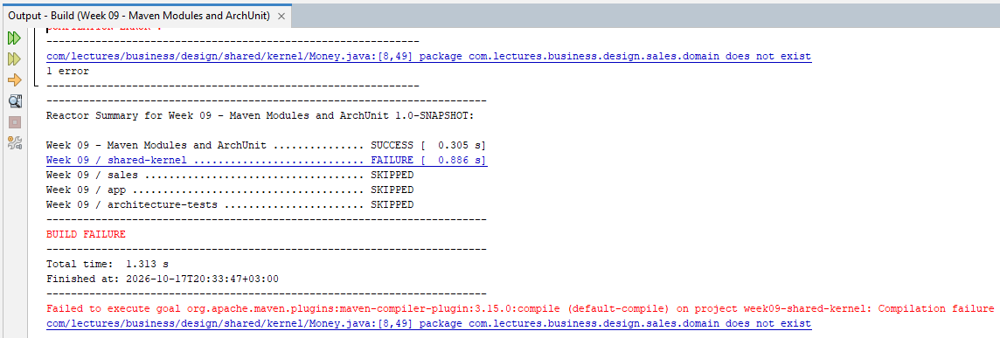

# Bölüm 9 - Maven Modülleri ve ArchUnit Kullanımı

Bu bölüme kadarki kod örneklerimizi tek bir Maven modülü altında gerçekleştirdik. Proje türünden olan root pom altında bölümlerin her birini ayrı jar paketleri halinde tasarladık. Bu daha çok ders konularını ayrı paketler halinde organize etmek istediğimiz için uyguladığımız bir pratikti. Pek tabii bir önceki bölümde iş nesnelerini, servisleri ve diğer bazı kavramları kendi paketlerine almaya başladık. Gerçek hayat çözümlerinde paket ve modüller arasındaki ilişkileri doğru tesis etmek oldukça önemlidir. Paketlerin aynı modül içerisinde yer almasının avantajları olduğu kadar dezavantajları da olabilir. Bu biraz da seçilen mimari yaklaşıma ve alınan kararlara *(çoğunlukla ADR-Architecture Decision Record maddelerinde açıkça belirtilir)* bağlıdır. Bu bölümde özellikle modül sınırlarını anlamlandırmaya da çalışacağız. Şu soruların cevaplarını bulmaya çalışacağız:

- Paket sınıfı ve modül sınırları neyi ifade eder? Derleyici hangisini kontrol edebilir?
- Modülleri katmanlara göre mi ayırmak gerekir yoksa bir özelliğe *(feature)* göre mi?
- Ortak paylaşılan iş birimleri için ayrı bir modül mü oluşturmak gerekir yoksa mevcut modüller içerisinde mi yer almalıdır?
- Mimari bir kararın kural olarak sayılması için ne gerekir ? *(Grep vs ArchUnit)*

## Modül Haritasının Hazırlanması

Son dersimize göre `week08-step4-mappers` modülünde dört paket bulunuyor; api, application, domain ve persistence. Soru şu; bunları modüller halinde bölmek istesek kaç modüle ihtiyacımız olur? İlk etapta buradaki her bir katmanın bir modül olarak ele alınabileceğini düşünebiliriz. Bu yanlış olmamakla birlikte her zaman en doğru çözüm değildir. Kobay Northwind senaryomuzu düşündüğümüzde aslında aşağıdaki gibi bir durumdan bahsedebiliriz.

```text
shared-kernel -> catalog, inventory, crm, sales, purchasing, shipping -> northwind-web(war)

                            -> quality/architecture-tests
```

Bu yaklaşıma göre hiçbir modül aslında bir katman *(layer)* değildir. Altı iş modülü vardır ve katmanlar her modülün içinde birer paket olarak bulunur. Bu stratejide paketleme özelliğe göredir *(package-by-feature)*, katmana göre değil. Dolayısıyla `com.northwind.inventory.reservation` gibi bir paket geçerliyken, `com.northwind.service` şeklinde bir paket geçerli değildir. Bunu aşağıdaki üç gerekçe ile de açıklayabiliriz.

- Katmanlara göre bölümleme yaptığımızda her iş değişikliğinin bütün modülleri dolaşma riski oluşur. Söz gelimi *siparişe indirim ekle* işi domain, application ve api modüllerini birlikte değiştirmeyi gerektirebilir. Üç modülü aynı **Pull Request** içinde değiştiriyorsak bu üç modülün aslında tek bir modül olduğunu varsayabiliriz. Yani modül sınırlarında bir sorun vardır.
- sales ve inventory modülleri arasındaki sınır oldukça anlamlıdır. İki ayrı iş alanı, iki ayrı takım ve iki farklı değişim hızı söz konusudur. domain ve application şeklinde katmanların olduğu bir kurguda ise bu sınırlar daha belirsiz hale gelir.
- Modüller arası bağımlılıkların yönetimi daha kolaydır. Özellikle ArchUnit gibi araçlarla modüller arası bağımlılık kurallarını test edebiliriz. Bu sayede istenmeyen bağımlılıkların da önüne geçebiliriz.

Asıl lab ortamında geliştireceğimiz projede yukarıdaki stratejiyi uygulayacağımızdan bu bölümde minyatür bir replikasını inşa etmeye çalışacağız. Aşağıdakine benzer bir iskeleti hedefliyoruz.

```text
project-root/
├── pom.xml
├── shared-kernel/      (Money, Address, Specification, DomainException vs burada yer alır)
├── sales/              (api, application, domain, persistence paket olarak burada yer alır)
├── app/                (Main ve öğrenme amaçlı kullandığımız anemik örnekler burada durur)
└── quality/
    └── architecture-tests/  (ArchUnit testleri de burada yer alır)
```

Dört modülden oluşan bu kurguda hiçbir modül bir katman *(layer)* değildir. İş yapan tek modülümüz sales modülüdür. *(Lab çalışmamızda ele alacağımız örnekte sales gibi beş modül daha olacak)* Ayrıca;

- `shared-kernel` modülü sadece genel *(generic)* tipleri barındırır. Money, Address, PostalAddress, Specification, DomainException vs. burada yer alır. Bir tipin bu modüle girip girmediğini belirlemek için, hangi iş modülüne ait olduğunu soramıyor olmamız gerekir. Söz gelimi OrderSpecifications, shared-kernel'e girmez zira Order'a özgü bir kavramdır. Buna karşın `Specification<T>` tam olarak generic bir kavramdır ve shared-kernel'de yer alır.
- Benzer şekilde IncompleteOrderException, InvalidStateTransitionException, OrderNotModifiableException, OrderNotFoundException gibi istisnalar da shared-kernel'e girmez. Zira bunlar da `sales` domain'ine özgüdür. Tabii `DomainException` genel bir türdür ve `shared-kernel`'de yer alır.
- Burada tartışmaya neden olabilecek iki tür de vardır; OrderId ve CustomerId. Tüm modüller için ortak görünebilirler ama sipariş müşterisi sipariş modülünün bir parçasıdır ve dolayısıyla `OrderId` ve `CustomerId` genellikle `sales` modülünde yer alır *(Bu DDD içerisinde de zor kararlar arasında yer alır. Tartışmaya açık.)*

> `week09-maven-modules-and-archunit` klasörünü dikkatlice inceleyelim. Root pom.xml'deki package özelliği ile alt klasörlerdeki package özelliklerinin ne olduğuna bakalım ve pom ile jar olmaları arasındaki farkları araştıralım.

## Sales Modülü

Satış modülünün amacı, siparişlerin yönetilmesi ve işlenmesidir. Bu modül, `api`, `application`, `domain` ve `persistence` paketlerini içerir ve iş mantığını kapsar. Aşağıdaki yapıya sahiptir.

```text
├── api/            OrderSummary, CustomerRevenue, SalesTotals, package-info
├── application/    OrderMapper, SalesReport, package-info
├── domain/         Order, OrderLine, OrderStatus, Customer, CustomerId, OrderId,
│                   OrderFactory, OrderIdGenerator, SequentialOrderIdGenerator,
│                   OrderSpecifications, DiscountPolicy, VolumeDiscountPolicy,
│                   CustomerTier, IncompleteOrderException,
│                   InvalidStateTransitionException, OrderNotModifiableException,
│                   OrderNotFoundException, package-info
└── persistence/    OrderRepository, InMemoryOrderRepository, package-info
```

Benzer kurgu test modülü için de geçerlidir.

```text
├── domain/         OrderTest, OrderStatusTest, CustomerTest, OrderQueryTest,
│                   CustomerIdTest, OrderIdTest, OrderFactoryTest, OrderBuilderTest,
│                   DiscountPolicyTest, OrderSpecificationsTest, OrderBuilder
├── persistence/    InMemoryOrderRepositoryTest
└── application/    SalesReportTest, OrderMapperTest
```

Sales modülü, `shared-kernel` modülüne bağımlıdır ama tam tersi geçerli değildir. Üstelik bu bağımlılığı pom.xml dosyasında da açıkça görebiliriz.

```xml
 <dependencies>
    <dependency>
        <groupId>com.lectures</groupId>
        <artifactId>week09-shared-kernel</artifactId>
    </dependency>
</dependencies>
```

Ufak bir deneme; Her şey week9 projesine taşındıktan sonra örneğin shared modülündeki Money sınıfına aşağıdaki satırı ekleyip derlemeyi deneyelim.

```java
import com.lectures.business.design.sales.domain.Order;
```

Aşağıdaki gibi bir derleme hatası alırız.



`shared-kernel`'in pom dosyasında sales modülüne bir bağımlılık eklenmediği için bu derleme hatasının alınması normaldir ve zaten istediğimiz bir şeydir. Aynı modül içinde sadece paketlerden oluşan bir tasarımda kalsaydık bu tür bir bağımlılık sorunuyla karşılaşmazdık. Tabii tam tersi durumda, yani sales modülündeki Order içerisinden shared-kernel modülündeki sınıflara erişmeye çalıştığımızda derleme hatası almayız çünkü sales modülü shared-kernel modülüne bağımlıdır. Buna göre;

| Hatalı Bağımlılık Yönü | Kim durdurur? |
| --- | --- |
| `shared-kernel` -> `sales` | Maven derleme zamanı |
| `sales.domain` -> `sales.persistence` | Maven durdurmaz eğer ikisi de aynı jar içerisindeyse |

## Uçtan Uca Çalışan Bir Smoke Test Yazmak

Bir uygulamada yeni sürüm çıktığımızda veya build değişikliği yaptığımızda sistemin en temel ve kritik fonksiyonelliklerinin çalışıp çalışmadığını hızlıca doğrulamak için uygulanan ön seviye testleri **smoke test** olarak adlandırılır *(Bu terim aslında donanım dünyasından geliyor. Yeni bir elektronik devreye ilk kez elektrik verildiğinde duman çıkıp çıkmadığına yani bir şeyin yanıp yanmadığına bakılmasından...)* Bu testlerde amaç yazılımın tüm detaylarını test etmekten ziyade ana işlevlerin çalışıp çalışmadığını görerek daha kapsamlı *(QA - Quality Assurance)* testlere geçmeden önce hızlı bir kontrol sağlamaktır. Yani sistemin ana işlevleri bile çalışmıyorsa diğer detayları test etmek için vakit kaybetmeye gerek yoktur. Artık projemiz biraz daha olgunlaştığına göre bu tip bir testi de ele almak doğru olacaktır. Örneğin repository'yi kuralım, satış raporunu alalım, rapordaki sayıların doğruluğunu kontrol edelim. Bunun için daha önceden kullandığımız **OrderBuilder** sınıfından da yararlanabiliriz *(Builder pattern konusuna bakarken değinmiştik)* Ancak bu sınıfımız şu anda sales modülündeki test paketinde yer alıyor. Bu yüzden sales modülünden bir `test-jar` yayınlayıp *(publish)* diğer modüllerde kullanmayı deneyeceğiz. Aslında, OrderBuilder'ı main paketine taşımak da bir çözüm olarak görülebilir ama bu durumda Test Fixture nesnesini üretime bağımlı hale getirmiş oluruz *(Gereksiz bir şekilde `sales.jar` ile birlikte her yere dağılır)*

> Test Fixture; Bir yazılım kodunu test etmeden önce sistemi belirli ve kontrollü bir başlangıç durumuna getiren hazırlık kodları ve verilerdir. Amaç, testlerin her defasında aynı koşullarda çalışmasını sağlamaktır. Örneğin bir teste başlamadan önce veritabanına önceden tanımlanmış örnek kullanıcıların atılması veya sahte ürün verilerinin yüklenmesi gibi. Derslerimizde ele aldığımız OrderBuilder tam olarak bu amaca hizmet etmektedir.

Bu amaçla, app modülünün test kaynaklarında *(`app/src/test/java`)* yer alan `com.lectures.business.design.app` paketine AppSmokeTest adında bir sınıf ekleyip içeriğini aşağıdaki gibi yazalım.

```java
package com.lectures.business.design.app;

import com.lectures.business.design.sales.api.CustomerRevenue;
import com.lectures.business.design.sales.application.OrderMapper;
import com.lectures.business.design.sales.application.SalesReport;
import com.lectures.business.design.sales.domain.OrderBuilder;
import com.lectures.business.design.sales.persistence.InMemoryOrderRepository;
import com.lectures.business.design.sales.persistence.OrderRepository;
import org.junit.jupiter.api.DisplayName;
import org.junit.jupiter.api.Test;
import java.math.BigDecimal;
import static org.assertj.core.api.Assertions.assertThat;

class AppSmokeTest {

    @Test
    @DisplayName("the whole stack answers one reporting question")
    void theStackWorksEndToEnd() {
        OrderRepository repository = new InMemoryOrderRepository();
        repository.save(OrderBuilder.anOrder()
                .withId(10248).forCustomer("VINET").withLine(11, "14.00", 10).shipped().build());
        repository.save(OrderBuilder.anOrder()
                .withId(10250).forCustomer("TOMSP").withLine(11, "99.00", 5).cancelled().build());
        SalesReport report = new SalesReport(repository, new OrderMapper());
        assertThat(report.revenueByCustomer())
                .containsExactly(new CustomerRevenue("VINET", new BigDecimal("140.00"), "TRY"));
        assertThat(report.totals().orderCount()).isEqualTo(1);
        assertThat(report.ordersOf("VINET")).hasSize(1);
    }
}
```

Bu test modüllerin birlikte çalıştığını kanıtlıyor. Davranış testleri sales modülünde yer alıyor, burada tekrar etmiyoruz.

## Mimari Test Yazmak

Bu bölümde göreceğimiz bir diğer test çeşidi ise alınan mimari kararları da korumayı sağlayan mimari testlerdir. Bunun için ArchUnit kütüphanesini kullanacağız. `quality\architecture-tests` modülündeki `pom.xml` dosyamızda bu amaçla bir bağımlılık ekledik.

```xml
<dependency>
    <groupId>com.tngtech.archunit</groupId>
    <artifactId>archunit-junit6</artifactId>
    <scope>test</scope>
</dependency>
```

ArchitectureTest sınıfını da aşağıdaki gibi geliştirebiliriz.

```java
package com.lectures.business.design.arch;

import com.lectures.business.design.shared.kernel.DomainException;
import com.tngtech.archunit.core.importer.ImportOption;
import com.tngtech.archunit.junit.AnalyzeClasses;
import com.tngtech.archunit.junit.ArchTest;
import com.tngtech.archunit.lang.ArchRule;
import java.util.Optional;
import static com.tngtech.archunit.lang.syntax.ArchRuleDefinition.classes;
import static com.tngtech.archunit.lang.syntax.ArchRuleDefinition.fields;
import static com.tngtech.archunit.lang.syntax.ArchRuleDefinition.noClasses;
import static com.tngtech.archunit.lang.syntax.ArchRuleDefinition.noMethods;
import static com.tngtech.archunit.library.GeneralCodingRules.NO_CLASSES_SHOULD_ACCESS_STANDARD_STREAMS;

@AnalyzeClasses(
        packages = {"com.lectures.business.design.sales", "com.lectures.business.design.shared"},
        importOptions = ImportOption.DoNotIncludeTests.class)
class ArchitectureTest {

    // ADR-0003 permission matrix
    @ArchTest
    static final ArchRule domain_does_not_see_other_layers = noClasses()
            .that().resideInAPackage("..sales.domain..")
            .should().dependOnClassesThat()
            .resideInAnyPackage("..sales.api..", "..sales.application..", "..sales.persistence..");

    @ArchTest
    static final ArchRule api_is_a_pure_contract = noClasses()
            .that().resideInAPackage("..sales.api..")
            .should().dependOnClassesThat()
            .resideInAnyPackage("..sales.domain..", "..sales.application..", "..sales.persistence..");

    @ArchTest
    static final ArchRule persistence_only_sees_domain = noClasses()
            .that().resideInAPackage("..sales.persistence..")
            .should().dependOnClassesThat()
            .resideInAnyPackage("..sales.api..", "..sales.application..");

    @ArchTest
    static final ArchRule shared_kernel_depends_on_no_business_module = noClasses()
            .that().resideInAPackage("..shared.kernel..")
            .should().dependOnClassesThat()
            .resideInAPackage("..sales..");

    //  Domain Conventions Check
    @ArchTest
    static final ArchRule domain_is_framework_free = noClasses()
            .that().resideInAnyPackage("..sales.domain..", "..shared.kernel..")
            .should().dependOnClassesThat()
            .resideInAnyPackage("jakarta..", "javax..", "java.sql..");

    @ArchTest
    static final ArchRule domain_has_no_setters = noMethods()
            .that().areDeclaredInClassesThat().resideInAPackage("..sales.domain..")
            .should().haveNameMatching("set[A-Z].*");

    @ArchTest
    static final ArchRule optional_is_not_a_field_type = fields()
            .should().notHaveRawType(Optional.class);

    @ArchTest
    static final ArchRule domain_exceptions_share_one_base = classes()
            .that().resideInAPackage("..sales.domain..")
            .and().haveSimpleNameEndingWith("Exception")
            .should().beAssignableTo(DomainException.class);

    //  Common Coding Rules
    @ArchTest
    static final ArchRule no_standard_streams = NO_CLASSES_SHOULD_ACCESS_STANDARD_STREAMS;

    @ArchTest
    static final ArchRule no_dumping_ground_packages = noClasses()
            .should().resideInAnyPackage("..util..", "..common..", "..helper..", "..misc..");
}
```

İlk etapta korkutucu görünebilir ancak sınıftaki her `@ArchTest` alanı bir mimari kararın çalıştırılabilir halidir. Dikkat edelim, bunlar metot değil `ArchRule` türünden `static` alanlardır ve ArchUnit her birini JUnit üzerinde ayrı bir test olarak koşturur. İlk dört kural ADR-0003'teki bağımlılık matrisini, sonraki dört kural ADR-0004'teki domain kurallarını, son iki kural da ADR-0005'teki ortak kodlama kurallarını doğrular. Yeri gelmişken bu ADR *(Architecture Decision Record)* kayıtlarına bir bakalım *(Lab projesinde bu ADR dokümanlarını daha detaylı bir şekilde ele alabiliriz)*

> ADR'ler [Michael Nygard'ın](https://adr.github.io/adr-templates/) önerdiği **Bağlam - Karar - Sonuçlar** formatını izler. Bir ADR'nin değeri yalnızca *ne* karar verildiğini değil, *neden* verildiğini, *hangi alternatiflerin elendiğini* ve *hangi bedelin göze alındığını* kayıt altına almasından gelir. Buradaki kayıtlara ek olarak bir de **Doğrulama** başlığı ekledik. Bu başlık kararın hangi araçla ve hangi kuralla korunduğunu gösterir. Hiçbir mekanizma tarafından korunmayan bir ADR zamanla kodun gerçeğini yansıtmayan bir dokümana dönüşür.

- [ADR-0003-Modül ve Paket Bağımlılıklarının Yönü](docs/adr/ADR-0003.md)
- [ADR-0004-Domain Modeli ve Paylaşılan Çekirdek Kuralları](docs/adr/ADR-0004.md)
- [ADR-0005-Ortak Kodlama Kuralları](docs/adr/ADR-0005.md)

Buna göre test sınıfındaki kuralların ne yaptığını ve hangi ADR'ye hizmet ettiğini aşağıdaki tablo ile özetleyebiliriz.

| **Kural *(ArchRule alanı)*** | **ADR** | **Neyi Doğrular?** |
| --- | :---: | --- |
| **domain_does_not_see_other_layers** | 0003 | `sales.domain` sınıflarının `sales.api`, `sales.application` veya `sales.persistence` paketlerindeki sınıflara bağımlı olmadığını doğrular. |
| **api_is_a_pure_contract** | 0003 | `sales.api` sınıflarının domain, application ve persistence paketlerine bağımlı olmadığını doğrular. shared-kernel ve JDK tiplerini kullanmasına izin verir. |
| **persistence_only_sees_domain** | 0003 | `sales.persistence` sınıflarının api veya application paketlerine bağımlı olmadığını doğrular. Domain ve shared-kernel tiplerini kullanabilir. |
| **shared_kernel_depends_on_no_business_module** | 0003 | `shared.kernel` sınıflarının hiçbir `sales` sınıfına bağımlı olmadığını doğrular. Maven'ın modül düzeyinde verdiği garantinin ikinci katmanıdır. |
| **domain_is_framework_free** | 0004 | `sales.domain` ve `shared.kernel` sınıflarının `jakarta`, `javax` veya `java.sql` paketlerine bağımlı olmadığını doğrular. |
| **domain_has_no_setters** | 0004 | `sales.domain` sınıflarında adı `set` + büyük harf kalıbına uyan metot bulunmadığını doğrular. Kalıba baktığı için `changeStatus` gibi bir metodu yakalamaz. |
| **optional_is_not_a_field_type** | 0004 | Analiz kapsamındaki *(sales ve shared-kernel)* hiçbir alanın ham tipinin `Optional` olmadığını doğrular. |
| **domain_exceptions_share_one_base** | 0004 | `sales.domain` içinde adı `Exception` ile biten sınıfların `DomainException`'a atanabilir olduğunu doğrular. İsme baktığı için farklı adlandırılmış bir exception sınıfı kuralın dışında kalır. |
| **no_standard_streams** | 0005 | Sınıfların `System.out` ve `System.err` alanlarına erişmediğini ve `Throwable.printStackTrace()` çağırmadığını doğrular. `System.in` bu kuralın kapsamında değildir. |
| **no_dumping_ground_packages** | 0005 | Hiçbir sınıfın adı tam olarak `util`, `common`, `helper` veya `misc` olan bir paket segmentinde yer almadığını doğrular. |

## Bir Kuralı Delmeyi Deneyelim

// EKLENECEK

---

## Sorular

1. Java paketleri ile Maven modülleri arasındaki temel fark nedir? Derleme sırasında her birinin hangi bağımlılıkları engelleyebildiğini araştıralım.
2. Katmanları ayrı Maven modülleri yapmak, siparişe indirim eklemek gibi bir değişiklikte neden birden fazla modül üzerinde değişiklik yapılmasına yol açar?
3. `package-by-feature` yaklaşımında modül ve paket sınırları nasıl kurulur? `sales` örneğindeki katman paketlerini düşünerek açıklayalım.
4. `shared-kernel` modülünün `sales` modülüne bağımlı olmaması neden önemlidir? Bu bağımlılık yönünü Maven nasıl koruyor?
5. `sales.domain` ile `sales.persistence` aynı JAR içindeyken Maven neden aralarındaki bağımlılığı tek başına engelleyemez? Bu kuralı hangi araçla test edebiliriz?
6. ADR-0003'teki matriste `application` satırı hiç ✗ içermiyor. Bu bir tasarım açığı mı, yoksa orkestrasyon katmanının doğası mı? `application` paketinin zamanla her şeyi bilen bir *god package*'a dönüşmesini hangi kurallarla engelleyebiliriz? Aynı matriste `api` -> `shared-kernel` hücresi ✓ olarak bırakıldı; `Money` gibi bir tipin dış sözleşmeye sızması istenmiyorsa bu hücre nasıl değişmeli?
7. `OrderBuilder` neden üretim kaynaklarına değil, test kaynaklarına konulmuştur? `test-jar` bu fixture'ın başka bir modülde kullanılmasını nasıl sağlamaktadır?
8. Smoke test ile sales modülündeki birim testlerin amaçları ve kapsadıkları alanlar bakımından farkları nelerdir?
9. `domain_is_framework_free` ve `domain_has_no_setters` kuralları hangi tasarım kararlarını korur? Bu tür kuralları ADR *(Architecture Decision Record)* ile ilişkilendirmenin faydası nedir?
10. ArchUnit testinde `DoNotIncludeTests` seçeneği ve analiz edilecek paketlerin açıkça belirtilmesi nasıl bir avantaj sağlar?
11. `no_standard_streams` kuralı neden `printStackTrace()` çağrılarını da yakalıyor? İş modülünde konsola yazmak yerine ne kullanmalıyız? `app` modülünü analiz kapsamının dışında tutmak, kurala bir istisna listesi eklemekten neden daha iyidir?

## Bu bölümün kodu

- [week09-maven-modules-and-archunit](src/week09-maven-modules-and-archunit)

```powershell
cd src\week09-maven-modules-and-archunit

# Bölüm 9'daki tüm modüllerin testleri
mvn test

# Yalnızca uygulama smoke test'i ve ihtiyaç duyduğu modüller
mvn -pl app -am test

# Yalnızca mimari testler ve ihtiyaç duyduğu modüller
mvn -pl quality/architecture-tests -am test
```
